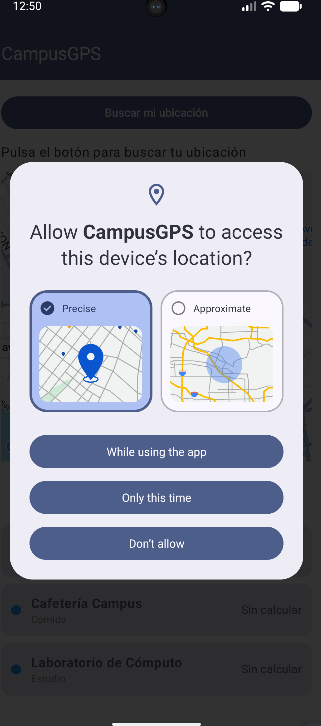
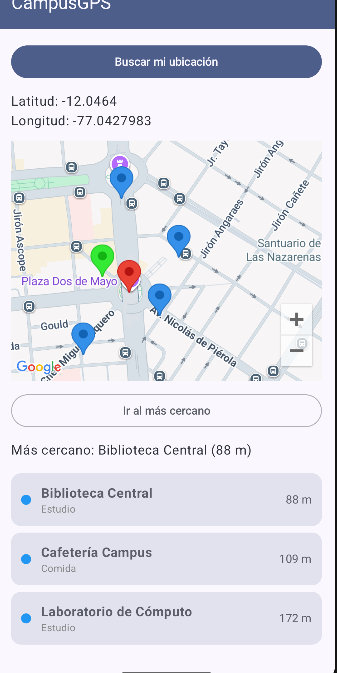
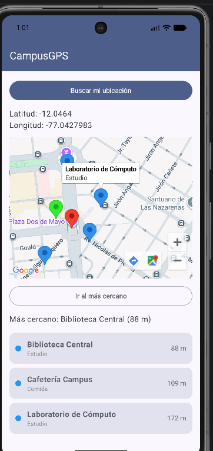
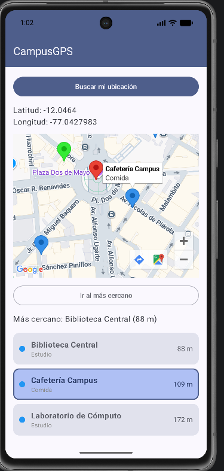
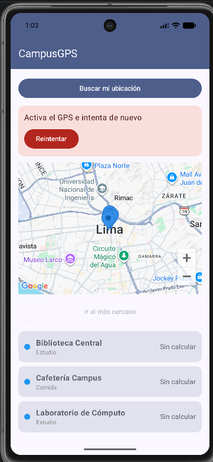

# CampusGPS

Aplicación Android que obtiene la ubicación del celular, la muestra en un mapa y te dice qué lugar del campus tienes más cerca. Muestra cinco puntos ficticios (biblioteca, cafetería, laboratorio, auditorio y estacionamiento) con su distancia en metros, ordenados del más cercano al más lejano.

- **Curso:** Programación en Móviles — Tecsup
- **Laboratorio:** GLAB-S13 · Localización Geográfica
- **Docente:** Juan León S.
- **Alumno:** Yony Ortiz
- **Tecnología:** Kotlin + Jetpack Compose + Material 3, Google Play Services Location, Maps Compose
- **Patrón:** MVVM + Repository (interface)

## Funcionalidades

- Pide el permiso de ubicación en tiempo de ejecución; si se niega, la app no se cierra.
- Muestra un mapa de Lima y mueve la cámara a tu posición con el marcador **Estás aquí**.
- Dibuja los 5 lugares del campus con marcadores azules (nombre y categoría).
- Calcula la distancia a cada lugar y los ordena en una lista.
- Al tocar una tarjeta, la cámara viaja a ese lugar y la tarjeta queda resaltada.
- Resalta en verde el lugar más cercano y el botón **Ir al más cercano** lleva la cámara hasta él.
- Maneja errores: permiso denegado (**Abrir ajustes**), GPS apagado (**Reintentar**) y sin Google Play Services.

## Estructura de paquetes

```
com.ortiz.campusgps/
├── MainActivity.kt
├── model/
│   └── Modelos.kt                  Posicion, Lugar, LugarConDistancia, UbicacionUi, TipoError
├── data/
│   ├── UbicacionRepository.kt      interface
│   ├── UbicacionRepositoryGoogle.kt implementación con FusedLocationProviderClient
│   ├── LugaresRepository.kt        interface
│   └── LugaresRepositoryLocal.kt   los 5 lugares
├── util/
│   ├── Distancia.kt                distanciaMetros()
│   └── Formato.kt                  formatearDistancia()
├── viewmodel/
│   ├── MapaViewModel.kt
│   └── CampusViewModelFactory.kt
└── ui/
    ├── PantallaMapa.kt
    ├── MapaUbicacion.kt
    ├── ListaLugares.kt
    ├── MensajeError.kt
    └── theme/
```

## Arquitectura MVVM + Repository

```
View (PantallaMapa, MapaUbicacion, ListaLugares, MensajeError)
   |  evento: pulsar el botón / tocar una tarjeta        ^  collectAsState()
   v                                                      |
ViewModel (MapaViewModel) ---------- StateFlow ----------->
   |  llama a las interfaces
   v
UbicacionRepository ---> UbicacionRepositoryGoogle (FusedLocationProviderClient)
LugaresRepository   ---> LugaresRepositoryLocal (los 5 lugares fijos)

util/ (Distancia, Formato): funciones puras que usa el ViewModel
```

| Capa | Conoce a | NO debe |
|---|---|---|
| View (ui/) | Solo a su ViewModel | Usar Repository, FusedLocationProviderClient ni calcular distancias |
| ViewModel | Solo a las interfaces de Repository | Conocer Composables ni recibir un Context |
| Repository | Google Play Services (en la implementación) | Exponer clases de UI |
| util/ | Funciones puras (distancia, formato) | Guardar estado |

## Capturas

| Permiso | Mapa con mi ubicación | Marcadores |
|---|---|---|
|  |  |  |

| Lista ordenada | Error |
|---|---|
|  |  |

## Configuración

1. Crear una clave de API en Google Cloud con **Maps SDK for Android** habilitado y restringida al paquete `com.ortiz.campusgps` y a la huella SHA-1 (`./gradlew signingReport`).
2. Agregar la clave en `local.properties` (este archivo está en `.gitignore` y no se sube):
   ```
   MAPS_API_KEY=tu_clave
   ```
3. Usar un emulador con Google Play y poner su ubicación en el punto base `-12.0464, -77.0428` (Extended controls → Location).

## Para pensar

**1. ¿Por qué FusedLocationProviderClient está dentro del Repository y no en el ViewModel?**
Porque el ViewModel solo debe conocer interfaces y no un `Context` ni las APIs de Google. El Repository se encarga de dónde salen los datos; así el ViewModel se puede probar con un repositorio falso y, si mañana cambia la fuente de ubicación, solo cambia la implementación.

**2. ¿Qué diferencia hay entre el permiso de ubicación y la clave de API de Maps? ¿Qué pasa si falta cada uno?**
El permiso lo concede el usuario y permite leer la ubicación del celular; la clave de API identifica a la app ante Google para poder dibujar el mapa. Sin permiso, el mapa se ve pero no se obtiene la posición (se muestra el mensaje con **Abrir ajustes**). Sin clave, la ubicación sí funciona pero el mapa sale gris o en blanco.

**3. ¿Por qué la clave va en local.properties y no en el código? ¿Qué harías si se subiera a GitHub por error?**
Porque `local.properties` está en `.gitignore` y no se sube al repositorio; si la clave estuviera en el código, cualquiera podría copiarla y usarla. Si se subiera por error, la eliminaría en Google Cloud, crearía una clave nueva y revisaría el `.gitignore`.

**4. ¿Dónde calculas la distancia y por qué no en el Composable?**
En el ViewModel (`actualizarDistancias`), usando la función pura `distanciaMetros` de `util/`. El Composable solo dibuja el estado; si calculara ahí, rompería MVVM, se recalcularía en cada recomposición y sería más difícil de probar.

**5. ¿Qué pasa con tu app si el usuario niega el permiso dos veces? ¿Cómo lo manejas?**
Android deja de mostrar el cuadro de permiso (queda negado de forma permanente). La app no se cierra: muestra el mensaje de error con el botón **Abrir ajustes**, que abre la pantalla de la app en Ajustes para que el usuario active la ubicación manualmente.
